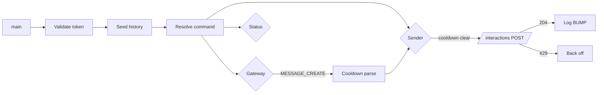

<div align="center">

# SupremeBumper

**Keep your server's Disboard bump on autopilot.**

A focused, single-file Python client that fires Disboard's `/bump` interaction the instant the 2-hour cooldown clears — no clicks, no missed windows, no babysitting.

[](https://www.python.org/)
[](https://docs.aiohttp.org/)
[](https://github.com/iamslop/SupremeBumper/blob/main/LICENSE)
[](https://github.com/iamslop/SupremeBumper/stargazers)
[](https://github.com/iamslop/SupremeBumper/network/members)
[](https://github.com/iamslop/SupremeBumper/issues)
[](https://github.com/iamslop/SupremeBumper/pulls)

[Features](#features) • [Quick Start](#quick-start) • [How It Works](#how-it-works) • [Configuration](#configuration) • [FAQ](#faq) • [Roadmap](#roadmap) • [Contributing](#contributing)

</div>

---

> [!WARNING]
> **Read this first.** This project automates a **user account** over the Discord Gateway. Self-botting violates Discord's Terms of Service, and automated bumping may breach Disboard's Terms of Service. Using this software can result in **account termination** or **server-level penalties**. It is provided for educational and research purposes only. The authors accept no responsibility for any consequences of use. **Run only on an account you are prepared to lose.**

---

## Table of Contents

- [Features](#features)
- [Screenshots](#screenshots)
- [Quick Start](#quick-start)
- [How It Works](#how-it-works)
- [Configuration](#configuration)
- [Logging](#logging)
- [Folder Layout](#folder-layout)
- [Project Structure](#project-structure)
- [FAQ](#faq)
- [Roadmap](#roadmap)
- [Known Limitations](#known-limitations)
- [Contributing](#contributing)
- [Security](#security)
- [Credits](#credits)
- [License](#license)

---

## Features

<table>
<tr>
<td width="50%" valign="top">

**Core**

- **Auto-Bump** — fires `/bump` the instant the cooldown clears
- **Real Interaction API** — sends `APPLICATION_COMMAND` payloads, not plain messages
- **History Seed** — pages back through channel history on startup to pick up the last bump
- **Ephemeral Parsing** — reads Disboard's `"wait another X minutes"` / `"wait X seconds"` replies
- **Gateway Reconnect** — WebSocket drops caught and retried automatically

</td>
<td width="50%" valign="top">

**Reliability**

- **Rate-Limit Aware** — HTTP `429` responses back off using `retry_after`
- **Command Resolution** — pulls `/bump`'s `id` and `version` from the guild command index
- **Live Status** — one-line status snapshot every second
- **Client Fingerprint** — identifies as the stable Discord desktop client
- **Single File** — one dependency, no build step, no config files

</td>
</tr>
</table>

---

## Screenshots

<div align="center">

### Startup

```text
================================================================
  DISBOARD bumper
  guild    : 123456789012345678
  channel  : 987654321098765432
  mode     : bump as soon as the cooldown clears
================================================================
[ACCOUNT ] YourName (123456789012345678)
[DISBOARD] last message 2024-01-01 12:00:00 (1.2 h ago)
[STATUS  ] last bump 12:00:00 (1.2 h ago)  |  next bump in 47m 12s  |  attempts 0
[COMMAND ] /bump resolved  |  id 987654321098765432
[SESSION ] connected as YourName (123456789012345678)  |  id abc12345...
[BUMP    ] sent 14:00:01  |  attempt #1
```

</div>

---

## Quick Start

### Prerequisites

| Requirement | Version | Purpose |
|-------------|---------|---------|
| **Python** | `3.10+` | `asyncio` features used throughout |
| **aiohttp** | `3.9+` | Async HTTP client + WebSocket |
| **Discord user token** | — | Authentication (not a bot token) |
| **Guild ID** | — | Server containing Disboard |
| **Channel ID** | — | Channel where `/bump` is permitted |


### Installation

```bash
# 1. Clone
git clone https://github.com/iamslop/SupremeBumper.git
cd SupremeBumper

# 2. Install the single dependency
pip install aiohttp

# 3. Open bump.py and fill in the three constants at the top
#    TOKEN, GUILD_ID, CHANNEL_ID
```

### Running

```bash
python bump.py
```

That's it. Leave it running in a terminal, `tmux`, `screen`, or a service manager. Press `Ctrl+C` to stop cleanly — the script logs an `EXIT` line and releases the gateway session.

---

## How It Works

SupremeBumper is a single `asyncio` process that runs three coroutines side by side:



### Architecture

1. **Token validation** — calls `/users/@me`; exits if rejected.
2. **History seed** — pages up to 10×100 channel messages backwards, finds the latest Disboard message, sets `cooldown_until = timestamp + 2h`.
3. **Command resolution** — fetches `/guilds/{GUILD_ID}/application-command-index`, pulls Disboard's `/bump` object (`id` + `version` required for the interaction payload).
4. **Gateway** — maintains a WebSocket to `wss://gateway.discord.gg/?v=10&encoding=json`, sends `identify` with a patched desktop-client payload, heartbeats at the server-provided interval, reconnects on drop.
5. **Sender** — loops forever; when `time.time() >= cooldown_until`, POSTs an interaction of `type: 2` (`APPLICATION_COMMAND`) to `/interactions` using a fresh snowflake nonce and the current `session_id`.
6. **Status** — prints `last bump / next bump / attempts` every second.

All work is client-side. The script talks to the same HTTP endpoints and Gateway the official Discord desktop client uses.

### Cooldown Detection

Disboard replies with an **ephemeral** message (flag `64`) in the same channel. Two reply shapes are parsed:

| Reply | Regex |
|-------|-------|
| `"Wait another 127 minutes before bumping again"` | `another\s+(\d+)\s+minute` |
| `"Please wait 30 seconds before retrying"` | `wait\s+(?:another\s+)?(\d+)\s+second` |

- **Minute matches** → `cooldown_until = now + minutes*60`, ready time logged.
- **Second matches** → `cooldown_until = now + seconds`.
- **Public confirmation** → `cooldown_until = message.timestamp + 2h`.
- **Duplicates** → deduplicated against `state["last_ephemeral"]`.

If Disboard changes wording and detection fails, `RETRY_GUARD` (20 s) caps how often the sender retries — no runaway spam.

---

## Configuration

Open `bump.py` and set the three values at the top:

```python
TOKEN      = "USER_TOKEN"   # user token of the account that will bump
GUILD_ID   = "SERVER_ID"    # server containing Disboard and the bump channel
CHANNEL_ID = "CHANNEL_ID"   # channel where /bump is permitted
```

### Getting IDs and Token

1. In Discord, go to **User Settings → Advanced → Developer Mode** and enable it.
2. Right-click your server → **Copy Server ID** → paste as `GUILD_ID`.
3. Right-click the bump channel → **Copy Channel ID** → paste as `CHANNEL_ID`.
4. Retrieve your account token from your own logged-in client (DevTools → Network → any request → `authorization` header). **Treat it exactly like a password.**

> [!CAUTION]
> Never commit `bump.py` to a public repo once real credentials are set. Add it to `.gitignore`, or move the three constants into a private `secrets.py` and import from it.

### Tunable Constants

| Constant | Default | Description |
|----------|---------|-------------|
| `RETRY_GUARD` | `20.0` | Minimum seconds between attempts when no cooldown is known |
| `STATUS_INTERVAL` | `1.0` | Seconds between status printouts |
| `APP_ID` / `BOT_ID` | `302050872383242240` | Disboard IDs — leave unchanged |
| `CMD_NAME` | `"bump"` | The command name to invoke |

---

## Logging

| Tag | Meaning |
|-----|---------|
| `ACCOUNT` | Token validated; account name and ID |
| `DISBOARD` | Last-known or newly-seen Disboard message |
| `COOLDOWN` | Parsed ephemeral wait message |
| `STATUS` | Periodic snapshot (last bump, next bump, attempts) |
| `COMMAND` | `/bump` command object resolved with its ID |
| `SESSION` | Gateway session established |
| `GATEWAY` | Session resumed after a drop |
| `BUMP` | Interaction accepted (HTTP 204) |
| `LIMIT` | HTTP 429; backing off |
| `WARN` | Non-fatal issue; will retry |
| `ERROR` | Network, gateway, or API error with reconnect info |
| `EXIT` | Clean shutdown via `Ctrl+C` |

All logs are line-buffered and go to `stdout` so they appear immediately even when piped.

---

## Folder Layout

The script is self-contained — nothing is written to disk at runtime.

```text
SupremeBumper/
├── bump.py           # the whole tool
├── README.md         # this file
├── LICENSE           # MIT
└── .gitignore        # recommended: exclude secrets.py
```

No config files, no cache directories, no downloaded assets.

---

## Project Structure

The file is a flat script organized into logical sections:

```text
Configuration
├── TOKEN, GUILD_ID, CHANNEL_ID
├── APP_ID, BOT_ID, CMD_NAME
├── RETRY_GUARD, STATUS_INTERVAL
└── API, GATEWAY, UA, HEADERS

State
└── state = { session_id, command, last_bot_ts, attempts,
              last_attempt, cooldown_until, last_ephemeral }

Helpers
├── snowflake()
├── log()
├── parse_time()
├── clock()
├── age_text()
├── message_summary()
├── last_message_text()
├── cooldown_text()
├── print_status()
└── banner()

Network
├── report_last_bot_message()   # history seed
├── identify_payload()          # gateway identify
└── fetch_command()             # command index

Loops
├── gateway()                   # WebSocket lifecycle
├── sender()                    # interaction poster
└── status_reporter()           # periodic snapshot

Entry
└── main() + __main__ guard
```

---

## FAQ

<details>
<summary><b>Is this a bot account?</b></summary>

No. It uses your **user token**, not a bot token. That's why it can invoke slash commands the way a real client does — and why it violates Discord's ToS.

</details>

<details>
<summary><b>Why not just send the text <code>/bump</code>?</b></summary>

Sending the literal text `/bump` does **not** invoke a slash command — Discord only treats it as a command when it arrives through the Interaction API. This script builds the interaction payload by hand using the resolved command object, which is exactly what the Discord client does under the hood.

</details>

<details>
<summary><b>What happens if Disboard changes its reply wording?</b></summary>

Cooldown parsing is text-based and may miss. The `RETRY_GUARD` (20 s) caps how often the sender retries, so worst case is a slower bump schedule, not spam.

</details>

<details>
<summary><b>Can I run multiple instances?</b></summary>

One process per account. Running two processes on the same token will fight over the gateway and trigger `invalid session` (opcode 9). For multiple servers, run one instance per account or use one server per instance.

</details>

<details>
<summary><b>Will I get banned?</b></summary>

Potentially, yes. Self-bots are explicitly disallowed by Discord's Terms of Service. This project exists for educational and research purposes only.

</details>

<details>
<summary><b>How do I keep the token out of Git?</b></summary>

Move the three constants into a private `secrets.py`:

```python
# secrets.py
TOKEN      = "..."
GUILD_ID   = "..."
CHANNEL_ID = "..."
```

Then in `bump.py`:

```python
from secrets import TOKEN, GUILD_ID, CHANNEL_ID
```

And add `secrets.py` to `.gitignore`.

</details>

---

## Roadmap

- [x] Single-file, dependency-light implementation
- [x] Gateway reconnect handling
- [x] Ephemeral cooldown parsing
- [x] History seed for last bump
- [x] Live status line
- [ ] `--config` flag to accept a JSON path instead of editing constants
- [ ] Graceful shutdown via signal handler on Windows
- [ ] Docker image and `docker-compose.yml` example
- [ ] Systemd unit file example
- [ ] Optional webhook notification on successful bump
- [ ] Metrics exporter (Prometheus-friendly)

---

## Known Limitations

- **Client fingerprint drift:** `identify_payload()` and `UA` mirror the desktop client (Windows, Chrome `120`, build `240000`). If Discord rejects `identify` with opcode `9`, update these to match the current stable client.
- **Cooldown parsing is text-based:** two regexes match Disboard's current wording. If the wording changes, detection silently falls back to `RETRY_GUARD`.
- **Single channel:** the script only watches and sends in `CHANNEL_ID`. Running it in a channel where Disboard isn't active in that guild just no-ops.
- **Session required:** interaction payloads include `session_id`, so the gateway must be connected before a bump can fire.
- **Token safety:** the token is stored in plaintext. Never commit, never share, rotate if leaked.
- **Account risk:** Discord's ToS prohibits self-bots. Bannable offense; run only on an account you're prepared to lose.

---

## Contributing

Contributions are welcome! Please open an issue first to discuss significant changes.

```bash
# 1. Fork and clone
git clone https://github.com/iamslop/SupremeBumper.git

# 2. Create a branch
git checkout -b feature/my-change

# 3. Install deps
pip install aiohttp

# 4. Make your change, test locally
python bump.py

# 5. Commit and push
git commit -m "feat: my change"
git push origin feature/my-change

# 6. Open a Pull Request
```

**Guidelines:**

- Keep the script single-file unless there's a strong reason not to.
- No new dependencies without discussion.
- No credentials, tokens, or personal data in commits.
- Follow the existing code style (PEP 8, `log()` for output).

---

## Security

Found a security issue? **Do not open a public issue.** Email the maintainers directly (see the repo's `SECURITY.md` once created). Please include:

- A description of the issue
- Steps to reproduce
- Potential impact
- Any suggested fix

Responsible disclosure is appreciated.

---

## Credits

- **[aiohttp](https://github.com/aio-libs/aiohttp)** — asynchronous HTTP client and WebSocket library
- **[Disboard](https://disboard.org/)** — target bot and command surface (`302050872383242240`)
- **[Discord](https://discord.com/developers/docs/)** — Gateway and `/interactions` API
- Built and maintained by [iamslop](https://github.com/iamslop)

---

## License

Released under the [MIT License](https://github.com/iamslop/SupremeBumper/blob/main/LICENSE).

```text
MIT License

Copyright (c) 2024 iamslop

Permission is hereby granted, free of charge, to any person obtaining a copy
of this software and associated documentation files (the "Software"), to deal
in the Software without restriction, including without limitation the rights
to use, copy, modify, merge, publish, distribute, sublicense, and/or sell
copies of the Software, and to permit persons to whom the Software is
furnished to do so, subject to the following conditions:

The above copyright notice and this permission notice shall be included in all
copies or substantial portions of the Software.

THE SOFTWARE IS PROVIDED "AS IS", WITHOUT WARRANTY OF ANY KIND, EXPRESS OR
IMPLIED, INCLUDING BUT NOT LIMITED TO THE WARRANTIES OF MERCHANTABILITY,
FITNESS FOR A PARTICULAR PURPOSE AND NONINFRINGEMENT. IN NO EVENT SHALL THE
AUTHORS OR COPYRIGHT HOLDERS BE LIABLE FOR ANY CLAIM, DAMAGES OR OTHER
LIABILITY, WHETHER IN AN ACTION OF CONTRACT, TORT OR OTHERWISE, ARISING FROM,
OUT OF OR IN CONNECTION WITH THE SOFTWARE OR THE USE OR OTHER DEALINGS IN THE
SOFTWARE.
```

---

<div align="center">

**If this project helped you, consider giving it a star — it really helps.**

Made with care and a lot of `asyncio`

[Back to Top](#supremebumper)

</div>
